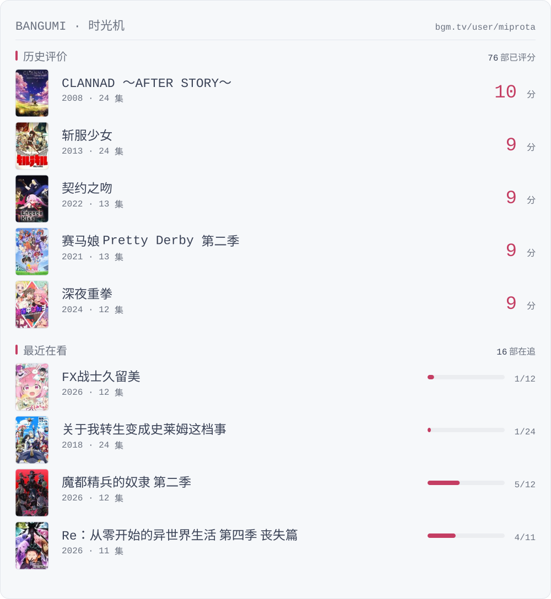
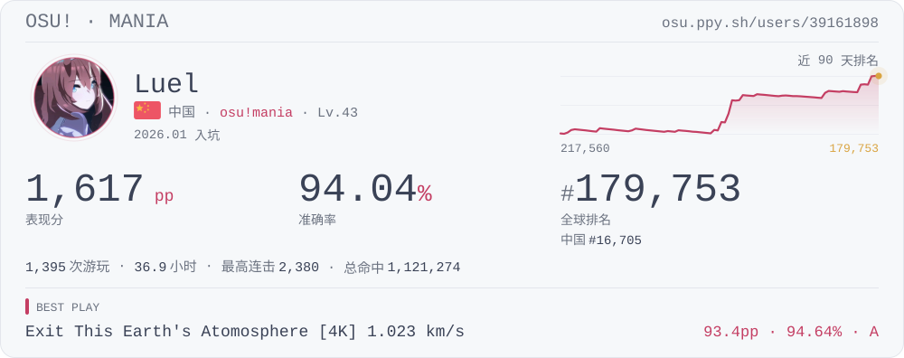
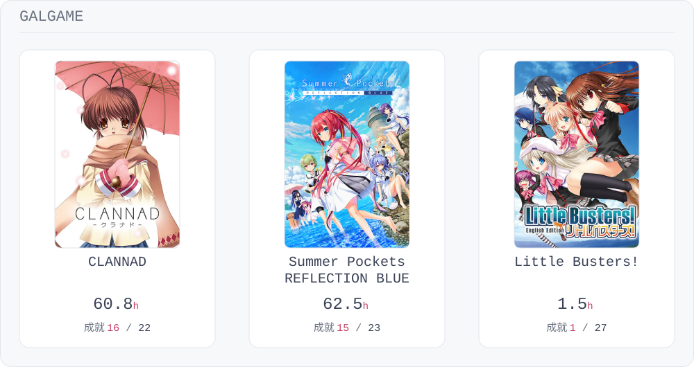
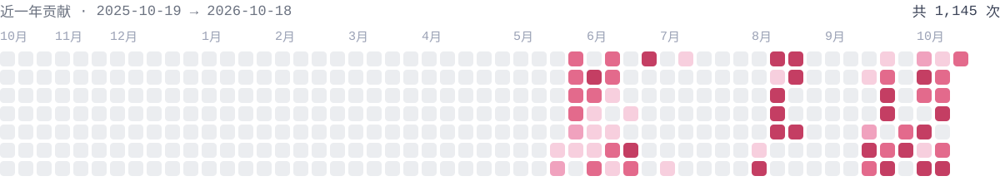

 

 

### 关于

大二在读。空闲的时间基本都花在 Linux 上了。

折腾的范围很小，主要集中在 Arch 系：壁纸、发行版、游戏启动器。
写代码主要用 **Node.js**、**Python** 和 **Rust**。

不写代码的时候喜欢看番、打歌。

### 在做

#### **[MipLinux](https://github.com/MipLinux/MipLinux)** 
    基于 Arch 的发行版，中文和 N 卡友好。
#### **[mip-paper](https://github.com/LaT-SKY/mip-paper)** 
    Plasma 的动态壁纸引擎，可以在 AUR 上下载体验。
#### **[Oddity](https://github.com/LaT-SKY/Oddity)** 
    《异环》的 Linux 启动器。

### 统计

#### 番剧

<picture>
  <source media="(prefers-color-scheme: dark)" srcset="./assets/bangumi-dark.svg">
  
</picture>

#### 音游

<a href="https://osu.ppy.sh/users/39161898/mania">
  <picture>
    <source media="(prefers-color-scheme: dark)" srcset="./assets/osu-dark.svg">
    
  </picture>
</a>

#### Galgame

<a href="https://steamcommunity.com/profiles/76561199114045991">
  <picture>
    <source media="(prefers-color-scheme: dark)" srcset="./assets/galgame-dark.svg">
    
  </picture>
</a>

#### 贡献

<picture>
  <source media="(prefers-color-scheme: dark)" srcset="./assets/heat-dark.svg">
  
</picture>

<picture>
  <source media="(prefers-color-scheme: dark)" srcset="https://streak-stats.demolab.com/?user=LaT-SKY&background=0D1224&border=1E2540&stroke=1E2540&ring=F5A9C8&fire=EFC77E&currStreakNum=EDEFF7&sideNums=EDEFF7&currStreakLabel=F5A9C8&sideLabels=8892B4&dates=6E7A99&hide_border=true&locale=zh">
  
</picture>

### 联系

- 博客 —— [miprota.cc](https://miprota.cc)
- 邮箱 —— [me@miprota.cc](mailto:me@miprota.cc)

Powered by Linux + 兴趣 + 运气

